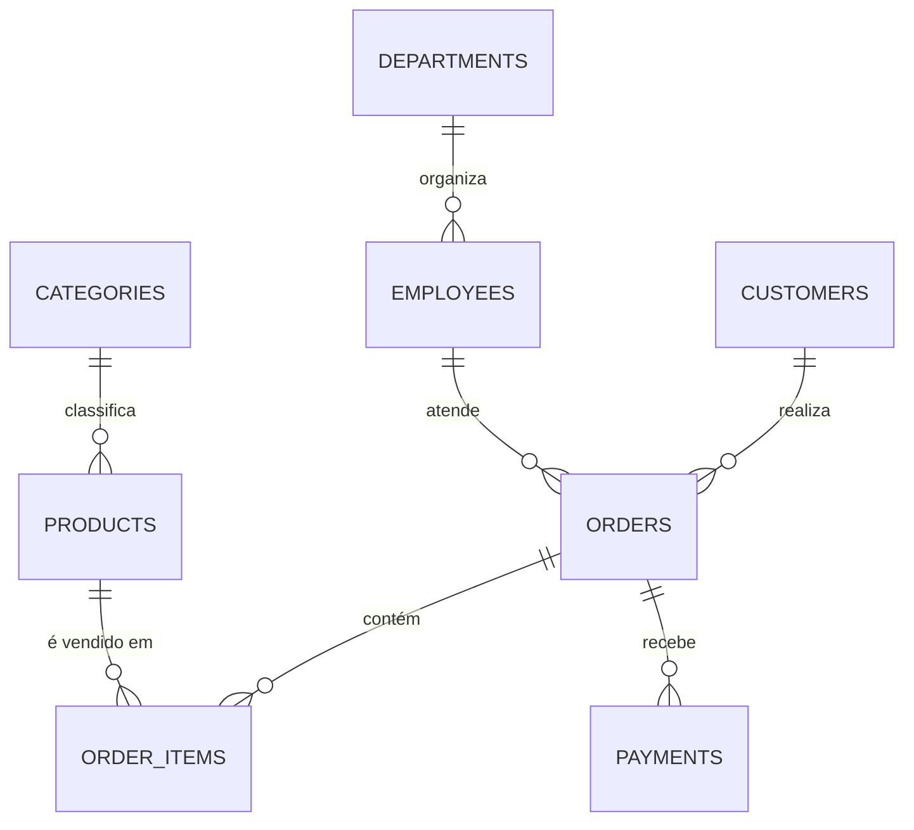

# SalesOps

**Banco de dados relacional para gestão comercial**


Projeto de portfólio desenvolvido para demonstrar modelagem relacional, integridade de dados e análise comercial com PostgreSQL.

O cenário cobre departamentos, funcionários, clientes, categorias, produtos, pedidos, itens e pagamentos.

---

## Visão geral

- Modelagem relacional normalizada
- Chaves primárias e estrangeiras
- Restrições `CHECK`, `UNIQUE` e `NOT NULL`
- Índices para relacionamentos e consultas frequentes
- View analítica para consolidar valores e saldos
- Consultas com agregações, CTEs e funções de data
- Histórico de preço preservado em cada item do pedido

## Índice

- [Modelo de dados](#modelo-de-dados)
- [Pré-requisitos](#pré-requisitos)
- [Como executar](#como-executar)
- [Estrutura do projeto](#estrutura-do-projeto)
- [Consultas disponíveis](#consultas-disponíveis)
- [Licença](#licença)

## Modelo de dados



O total de cada pedido é calculado a partir dos itens e do desconto. Ele não é armazenado em `orders`, evitando duplicidade e inconsistência.

A view `sales.v_order_summary` consolida subtotal, desconto, total, valor recebido e saldo em aberto.

## Pré-requisitos

- PostgreSQL 15 ou superior
- Cliente `psql` disponível no terminal
- Permissão para criar um banco de dados local

## Como executar

1. Crie um banco vazio:

```bash
createdb salesops
```

2. Execute os scripts na ordem:

```bash
psql -d salesops -f sql/01_schema.sql
psql -d salesops -f sql/02_seed.sql
psql -d salesops -f sql/03_analyses.sql
```

> `02_seed.sql` destina-se a uma instalação nova do schema.

### Reiniciar o ambiente

Para recriar o banco e restaurar os dados de demonstração:

```bash
dropdb --if-exists salesops
createdb salesops
psql -d salesops -f sql/01_schema.sql
psql -d salesops -f sql/02_seed.sql
```

## Estrutura do projeto

```text
.
├── README.md
├── LICENSE
└── sql
    ├── 01_schema.sql
    ├── 02_seed.sql
    └── 03_analyses.sql
```

## Consultas disponíveis

`sql/03_analyses.sql` inclui análises de:

1. Receita recebida por mês
2. Produtos mais vendidos
3. Vendas por pessoa responsável
4. Pedidos com saldo em aberto
5. Clientes com maior valor vendido

### Regras de cálculo

- **Receita recebida:** pagamentos com status `paid` associados a pedidos não cancelados.
- **Valor vendido:** itens e descontos de pedidos não cancelados, independentemente do pagamento.
- **Saldo em aberto:** total do pedido menos os pagamentos efetivamente recebidos.

## Licença

Este projeto está licenciado sob a licença MIT. Consulte o arquivo [LICENSE](./LICENSE) para mais detalhes.
